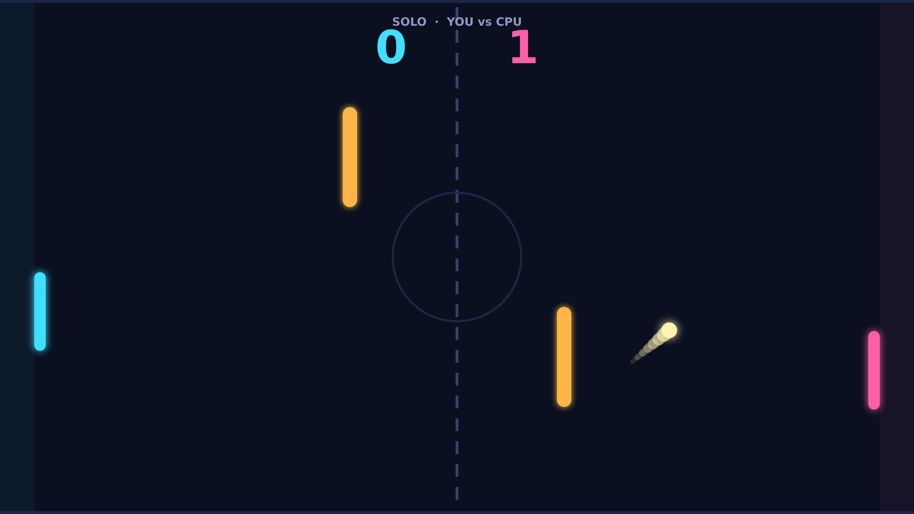
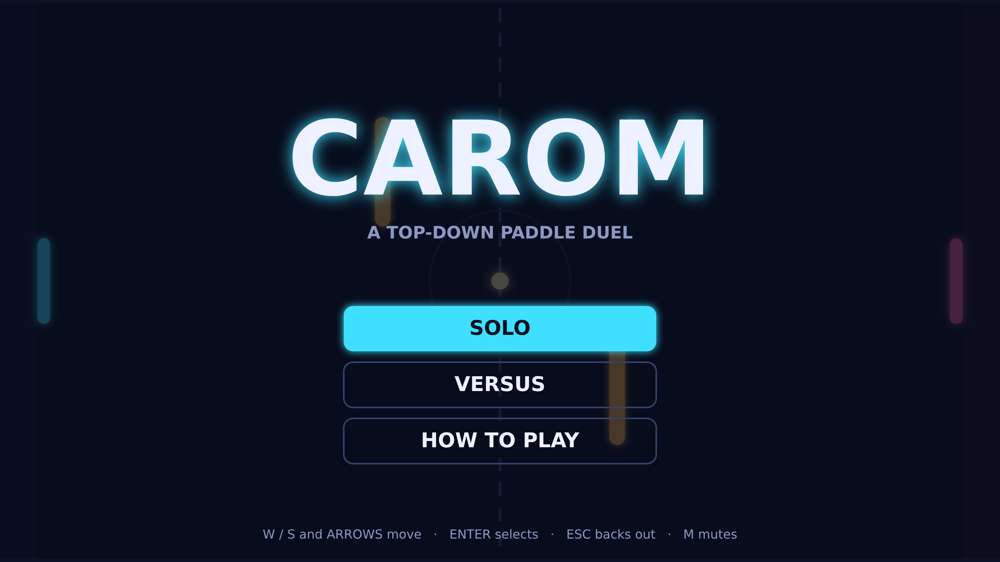

# Carom

Carom is a paddle duel played from above on a dark, glowing field. Two paddles
guard the goals at either edge, a ball streaks between them with a trail of
light behind it, and two amber bars stand in the middle of the field waiting to
send a careless shot somewhere you did not intend. Take the left paddle against
the machine in Solo, or share a keyboard with a friend in Versus.

A match opens with a short hold at the center circle, then the ball is served
toward the player who was last scored on. Early rallies are gentle: the ball
leaves at a modest pace, and every paddle strike adds a little speed until it is
screaming across the field near the cap. Where you catch the ball on your paddle
sets the angle it leaves at, so the edges open up sharp diagonals while the
middle sends it straight back.

Spin is what turns Carom from a reflex test into a duel. Strike the ball while
your paddle is moving and the ball's flight bends in the direction you were
travelling, then straightens out as the spin fades over the next second. A
hard, swiping return curls around an obstacle and dips behind your opponent's
paddle; a quiet, still block sends the ball back flat and lets them set up the
next shot. Learning when to swing and when to hold is the whole game.

The obstacles make every rally a bank-shot puzzle. The ball bounces off them at
full speed, and with spin on it a shot that looks like it is heading straight
into a bar can wrap around it instead. Matches run to eleven points with a
two-point lead, so a close game stretches into deuce and the player who reads
the angles best takes it.
